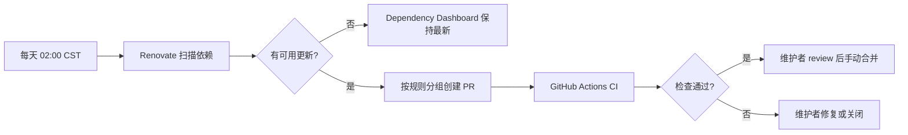

# 依赖更新自动化（Renovate + GitHub Actions）

本项目使用 [Renovate](https://docs.renovatebot.com/) 自动检查 Flutter、Dart、Android Gradle 和 GitHub Actions 的依赖更新，并通过 GitHub Actions 做验证。Renovate 只创建 PR，所有更新由维护者 review 后手动合并。

## 工作流程



| 文件 | 作用 |
| --- | --- |
| `renovate.json5` | Renovate 更新策略：分组、人工审查、忽略路径、安全更新等 |
| `.github/workflows/renovate.yml` | 定时/手动运行 Renovate，负责创建分支和 PR |
| `.github/workflows/renovate-config.yml` | 修改 Renovate 配置时校验语法和规则 |
| `.github/workflows/dart.yml` | 现有 CI：安装依赖、生成代码、静态分析、测试；同时负责 tag 发布 |

## 一次性配置

### 1. 创建 Renovate 专用的 GitHub Token

Renovate 需要以你的身份创建分支、PR 和 Dependency Dashboard issue。推荐使用 **Fine-grained personal access token**：

仓库：`iDevOrz/wan_android`

| 权限 | 级别 | 用途 |
| --- | --- | --- |
| Metadata | Read | 基础仓库信息 |
| Contents | Read and write | 创建更新分支、修改依赖文件 |
| Pull requests | Read and write | 创建/更新 PR |
| Issues | Read and write | 创建 Dependency Dashboard |
| Workflows | Read and write | 更新 `.github/workflows/*.yml` 中的 action 版本 |
| Commit statuses | Read | 读取传统 commit status |

> GitHub 当前不允许 Fine-grained PAT 调用 Checks API，所以权限列表里没有 `Checks` 选项，也不需要选。Renovate 创建 PR 不依赖它；如果以后想启用自动合并，并让 Renovate 根据 GitHub Actions 的 check runs 判断，请改用 Classic PAT（`repo` + `workflow`）或 GitHub App Token。

> 关键点：不要使用默认的 `GITHUB_TOKEN` 运行 Renovate。`GITHUB_TOKEN` 创建的 PR 不会触发新的 workflow，PR 上的 CI 不会运行。必须使用 PAT 或 GitHub App Token。

如果使用 Classic PAT，勾选 `repo` 和 `workflow` 即可。

### 2. 添加仓库 Secret

进入 **Settings → Secrets and variables → Actions → New repository secret**：

- Name: `RENOVATE_TOKEN`
- Value: 上一步创建的 PAT

### 3. 配置分支保护

本项目**不启用自动合并**，Renovate 只负责创建 PR。建议保护 `main`，确保手动合并前 CI 必须通过：

**Settings → Branches → Add branch ruleset / Add rule**，保护 `main`：

- 勾选 **Require a pull request before merging**
- 勾选 **Require status checks to pass before merging**
- 必选检查：选择 `Dart & Release` workflow 中的 `build` job（GitHub 界面可能显示为 `build` 或 `Dart & Release / build`）
- 建议勾选 **Require branches to be up to date before merging**

不需要开启 **Allow auto-merge**；即使仓库开启了，`renovate.json5` 中的 `automerge: false` 也不会让 Renovate 自动合并。

### 4. 首次运行

进入 **Actions → Renovate → Run workflow**，可以先勾选 `dry_run` 查看计划，确认无误后再正常运行。

首次成功运行后，Renovate 会在 Issues 中创建 **Dependency Dashboard**，后续所有待处理更新、被跳过的更新和速率限制状态都会汇总在那里。Renovate 只会创建 PR，不会自动合并任何 PR。

## 更新策略

`renovate.json5` 当前的策略：**所有更新只创建 PR，不会自动合并**，由你 review 后决定合并、修改或关闭。

| 依赖类型 | 行为 |
| --- | --- |
| Flutter SDK（`.fvmrc`） | 独立 PR，人工验证 |
| Dart SDK 约束（`environment.sdk`） | Renovate 跳过，随 Flutter 升级手动调整 |
| 运行时依赖 patch | 合并为一个 PR，人工审查 |
| 运行时依赖 minor / major | 独立 PR，人工审查 |
| 开发依赖 minor / patch | 合并为一个 PR，人工审查 |
| 开发依赖 major | 独立 PR，人工审查 |
| GitHub Actions minor / patch | 合并为一个 PR，人工审查 |
| GitHub Actions major | 独立 PR，人工审查 |
| Sentry 相关包 | 合并为一个 PR，人工审查（版本相互耦合） |
| Riverpod 相关包 | 合并为一个 PR，人工审查（需同步 `dependency_overrides`） |
| Android Gradle / AGP / Kotlin | 合并为一个 PR，人工审查 |
| `pubspec.lock` 维护 | 每周一凌晨创建 PR，人工审查 |
| 安全漏洞更新 | 立即创建 PR，带 `security` 标签，人工审查 |

> 注意：Renovate 的 pub 管理器不会更新 `dependency_overrides`（本项目中的 `riverpod` 覆盖），这部分需要手动跟进。Dart SDK 约束也被显式关闭：Renovate 在升级 `environment.sdk` 时仍使用当前 `.fvmrc` 的 Flutter，可能因为 Dart 版本不匹配导致 `pub get` 失败；建议先合并 Flutter SDK PR，再手动调整 Dart 约束。

其他保护措施：

- `minimumReleaseAge: "3 days"`：新版本发布 3 天后才创建 PR，降低恶意包和刚发布的破坏性版本带来的风险。
- `osvVulnerabilityAlerts: true`：结合 OSV 漏洞库检查依赖安全公告。
- `prConcurrentLimit`：限制同时打开的 PR 数量，避免刷屏。
- `ignorePaths`：忽略 `build/`、`.dart_tool/`、`.fvm/`、`Pods/` 等目录。

## 为什么不用 `renovatebot/github-action`

Renovate 的 pub 管理器在更新 `pubspec.yaml` 后，需要执行 `flutter pub upgrade` 来同步 `pubspec.lock`。官方 `renovatebot/github-action` 的容器内没有 Flutter SDK，直接使用会导致 lockfile 更新失败或 PR 中 lockfile 与 pubspec 不一致。

因此 `.github/workflows/renovate.yml` 的做法是：

1. 用 FVM 配置安装项目对应版本的 Flutter。
2. 用 `actions/setup-node` 安装 Node.js 24。
3. 直接运行 Renovate CLI，并设置 `RENOVATE_BINARY_SOURCE=global`，让 Renovate 使用 runner 上的 Flutter/Dart。

## 手动运行与本地验证

在 GitHub Actions 页面手动触发：

```bash
gh workflow run renovate.yml -f dry_run=true
gh workflow run renovate.yml -f dry_run=false -f log_level=debug
```

本地校验配置（需要 Node.js 24）：

```bash
npx --yes --package renovate@44 renovate-config-validator renovate.json5
```

本地 dry-run（会访问 GitHub API，但不会创建分支/PR）：

```bash
export RENOVATE_TOKEN="ghp_xxx"
export RENOVATE_REPOSITORIES="iDevOrz/wan_android"
export RENOVATE_PLATFORM="github"
export RENOVATE_CONFIG_FILE="renovate.json5"
export RENOVATE_DRY_RUN="full"
export RENOVATE_BINARY_SOURCE="global"
npx --yes renovate@44
```

## 常用调整

### 如果以后想开启自动合并

当前 `automerge: false` 全局关闭自动合并。如果以后只想对开发依赖和 GitHub Actions 开启：

1. 在对应 `packageRules` 中加 `automerge: true`。
2. 如需使用 GitHub 原生 auto-merge，将 `platformAutomerge` 改为 `true`，并在仓库开启 **Allow auto-merge**。
3. 配置分支保护，要求 CI 检查通过。

### 只允许补丁更新自动合并（可选）

在对应 `packageRules` 中把 `matchUpdateTypes` 限制为 `["patch"]`，并设置 `automerge: true`。

### 忽略某个依赖

```json5
{
  packageRules: [
    {
      matchDepNames: ["some_package"],
      enabled: false,
    },
  ],
}
```

### 调整执行时间

修改 `.github/workflows/renovate.yml` 中的 cron。GitHub Actions 使用 UTC：

- 北京时间 02:00 = UTC 18:00（前一天）
- 当前配置：`0 18 * * *`

`renovate.json5` 中的 `schedule` 使用 `Asia/Shanghai` 时区，控制 Renovate 实际创建 PR 的时间窗口。

## 排查

### Renovate PR 没有触发 CI

确认 `RENOVATE_TOKEN` 是 PAT 或 GitHub App Token，而不是 `GITHUB_TOKEN`。`GITHUB_TOKEN` 触发的 PR 事件会被 GitHub 抑制，不会启动新的 workflow。

### PR 中 `pubspec.lock` 没有更新

查看 Renovate job 日志中是否出现 `flutter pub upgrade` 或 `Failed to update lock file`。常见原因：

- Flutter 没有安装成功（检查 `Set up Flutter` 步骤）。
- `RENOVATE_BINARY_SOURCE` 不是 `global`。
- 依赖版本约束无法解析。

### Renovate 会自动合并吗？

不会。`renovate.json5` 中设置了 `automerge: false` 和 `platformAutomerge: false`，Renovate 只创建 PR。合并操作始终由你手动完成。

### 配置校验失败

先本地运行：

```bash
npx --yes --package renovate@44 renovate-config-validator renovate.json5
```

根据输出修正 JSON5 语法或无效配置项。

### Gradle 文件被重复更新

仓库当前同时存在 Groovy DSL 和 Kotlin DSL 的 Gradle 文件（例如 `android/settings.gradle` 与 `android/settings.gradle.kts`）。Renovate 可能同时更新两套文件。建议完成 Gradle Kotlin DSL 迁移后删除旧文件，或在 `ignorePaths` 中排除暂不使用的文件。

## 安全建议

- PAT 只授予上述最小权限，定期轮换。
- 保持 `minimumReleaseAge`，不要为了“最新”完全关闭发布冷却期。
- 本项目关闭自动合并，所有依赖更新由维护者 review 后手动合并；不要为了让 Renovate“自动处理”而开启 `automerge`。
- 不要在 Renovate 中配置 `postUpgradeTasks` 执行不可信脚本。
- Dependency Dashboard 中的安全更新应优先处理。
